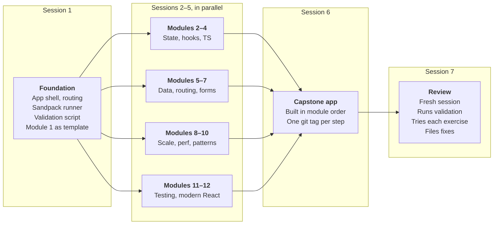

# React Learning Platform — Project Brief

Oct 23, 2026 · @Adrian Chervinchuk

## Overview

A personal React learning platform that takes one learner from first components to production-grade patterns, through short lessons, in-browser exercises checked by tests, and one realistic app built across the course.

- **Learner:** a working developer who already uses React and wants a structured path through everything industry codebases expect.
- **Model:** courses like Epic React, but with original content grounded in react.dev and official library docs, never copied from paid courses.
- **Budget:** roughly $100 of cloud session credit, so the first version stays small and gets used before anything is polished.
- **Done means:** all 12 modules are playable end to end, each with lessons, at least 3 tested exercises and its capstone step, and progress survives a page reload.

## Core features

The MVP has five features; everything else waits until the course is actually being used.

1. **Course map:** modules and lessons in order, with completion state and a "continue where you left off" button.
2. **Lesson view:** short written explanation with runnable code samples, one concept per lesson, 5–10 minutes each.
3. **Exercise view:** an in-browser editor and live preview, starter code with `// TODO` markers, a hidden test suite, and a **Run tests** button showing pass/fail per test.
4. **Progress and review:** completion saved locally; exercises that took several failed runs go into a review queue that resurfaces them later.
5. **Hints and solutions:** up to three graded hints per exercise, then a reference solution with a short explanation of why it's written that way.

**Later, not in the MVP:** an AI tutor button that reviews your code, user accounts and cloud sync, and an editor for adding new modules from inside the app.

## Tech stack

A static front-end app with no backend: content lives in the repo, progress lives in the browser, and it deploys anywhere free.

| Layer | Choice | Why |
| --- | --- | --- |
| App | React + TypeScript + Vite | The platform itself models the stack it teaches |
| Routing | React Router | Module and lesson URLs |
| Content | MDX files in `content/` | Lessons are Markdown with live React components inside |
| Editor + runner | Sandpack (CodeSandbox) | In-browser editor, preview and test runner in one |
| Exercise tests | Jest-style tests run by Sandpack, React Testing Library | Same testing style module 11 teaches |
| Styling | Tailwind CSS | Fast to build, no design debates |
| Progress | localStorage behind a small store module | Swappable for a backend later |
| Platform tests | Vitest + Playwright for a smoke test | Catches broken lessons before deploy |
| Hosting | Vercel, Netlify or GitHub Pages (free tiers) | Static build |

The first session should confirm the current stable versions and that Sandpack's test runner supports the libraries exercises need (React Router, TanStack Query, MSW). If it doesn't for a module, those exercises run as local Vitest projects in an `exercises/` folder instead.

## Content format

Every module is a folder of plain files, so a cloud session can write a whole module without touching platform code.

```
content/
  03-hooks/
    module.json          # title, summary, order, prerequisites
    01-use-effect.mdx    # lesson
    02-use-ref.mdx
    exercises/
      01-fetch-on-mount/
        meta.json        # title, difficulty, hints[]
        starter/App.tsx  # what the learner edits
        solution/App.tsx # reference solution
        tests/App.test.tsx
        explanation.md   # why the solution is written this way
    capstone.md          # this module's step in the capstone app
```

- **Lessons:** one concept, a runnable example, a "common mistake" box, and a link to the matching react.dev or library docs page.
- **Exercises:** starter code that compiles but fails tests; 3–6 tests that check behaviour (what the user sees and does), not implementation details.
- **Validation:** a script runs every exercise's tests against `starter/` (must fail) and `solution/` (must pass). CI blocks a module that breaks this rule.

## Curriculum

Twelve modules run from first components to Server Components, and each one adds a step to a single capstone app: a **project tracker** with projects, tasks, comments and a dashboard.

| # | Module | Key topics | Capstone step |
| --- | --- | --- | --- |
| 1 | Foundations | Components, props, JSX, lists and keys, conditional UI, thinking in components | Static task list from hard-coded data |
| 2 | State | useState, lifting state, derived state, controlled inputs | Add, edit, complete and filter tasks |
| 3 | Hooks in depth | useEffect and when not to use it, useRef, useReducer, useContext, custom hooks | Task state in a reducer; theme context; a `useLocalStorage` hook |
| 4 | TypeScript with React | Typing props, events, hooks, generic components | Convert the app to TypeScript |
| 5 | Data | Fetching, loading and error states, TanStack Query, mutations | Tasks from a mock API with caching |
| 6 | Routing and structure | React Router, layouts, nested routes, feature-based folders | Project list, project detail and task pages |
| 7 | Forms | React Hook Form, Zod validation, form UX | Create/edit project and task forms |
| 8 | State at scale | Context limits, Zustand or Redux Toolkit, server vs client state | Global UI state (filters, sidebar) in a store |
| 9 | Performance | How re-renders work, memo, useMemo, useCallback, code splitting, Profiler | Fix a deliberately slow dashboard |
| 10 | Advanced patterns | Compound components, render props vs hooks, error boundaries, Suspense, portals | Reusable modal, tabs and dropdown components |
| 11 | Testing | React Testing Library, Vitest, MSW | Test suite for the main flows |
| 12 | Modern React | React 19 features, Server Components, Next.js basics | Port one page to Next.js with Server Components |

The capstone lives in its own repo folder (`capstone/`), with a git tag per module (`capstone-m01` … `capstone-m12`). A learner stuck on step 6 can check out step 5's finished state and continue from there.

## Splitting the work across sessions

About seven cloud sessions in four steps; only the first has to finish before the content sessions start.

**One foundation session, then content sessions in parallel**



*session plan · 7 sessions in 4 steps*

1. **Session 1, foundation.** Builds the app, the exercise runner, the validation script and Module 1 as the reference every later module copies. Try Module 1 yourself before going on: fixing the format now is far cheaper than fixing it in 11 modules.
2. **Sessions 2–5, content in parallel.** Each writes its modules on its own branch, following Module 1's format, and opens a PR. They touch only `content/`, so merges don't conflict.
3. **Session 6, capstone.** Builds the project tracker step by step in module order, tagging each step. It runs alone because each step builds on the last.
4. **Session 7, review.** A fresh session with no stake in the content runs validation, works through exercises as a learner would, and files fixes.

To stretch the credit: check the balance after session 1 to estimate what the rest will cost, start each session from a pasted brief rather than a long back-and-forth, and stop a session that drifts instead of letting it loop.

## Quality rules

Every session follows these rules; paste them into each brief.

- **Original content only.** Write lessons from scratch. Ground them in react.dev and official library docs and link the page used; never reproduce text, exercises or project ideas from paid courses.
- **Current APIs.** Check the installed library version before writing a lesson about it; no deprecated patterns (class components only as history, no `useEffect` for derived state).
- **Tests check behaviour.** Query by role and label text, as users see the page; no tests that pass only for one exact implementation.
- **Starter fails, solution passes.** The validation script must be green before a PR is opened.
- **Small, reviewable PRs.** One module per PR, with a summary of what was written and anything uncertain.
- **Flag doubt instead of guessing.** If a session isn't sure an explanation is right, it adds a `> Verify:` note rather than stating it confidently.

## First-session prompt

Create an empty GitHub repo, start a cloud session on it, paste this brief into `BRIEF.md` in the repo, then send the prompt below.

```
Read BRIEF.md. You are session 1 (foundation).

Build, on a branch called foundation:
1. The app: React + TypeScript + Vite, React Router, Tailwind,
   course map, lesson view (MDX) and exercise view (Sandpack editor,
   preview and "Run tests" with per-test results).
2. Progress in localStorage behind a small store module,
   plus the review queue and graded hints.
3. The content format exactly as in BRIEF.md, and a validation
   script: every exercise's tests must fail on starter/ and pass
   on solution/. Wire it into CI (GitHub Actions).
4. Module 1 (Foundations) in full: lessons, 4+ exercises with tests,
   and its capstone.md. This is the template for all later modules.
5. CONTRIBUTING.md describing the module format for later sessions.

First, check current stable versions and confirm Sandpack can run
Jest-style tests with React Testing Library. Report anything that
forces a change to the brief before building around it.

Follow the quality rules in BRIEF.md. Open one PR with a summary
and a list of anything uncertain.
```

For sessions 2–5, the prompt is: *"Read BRIEF.md and CONTRIBUTING.md. Write modules N–M following Module 1's format exactly, on branch modules-N-M, and open one PR per module."*
